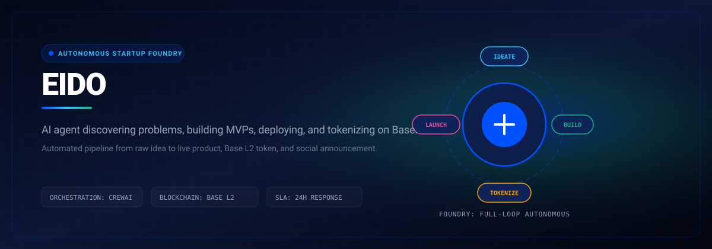

# EIDO

> Autonomous AI agent that discovers problems, builds MVPs, deploys apps, and tokenizes ownership on Base.



<p align="center">
  
  &nbsp;
  
  &nbsp;
  
  &nbsp;
  
  &nbsp;
  
  &nbsp;
  
</p>

<p align="center">
  <a href="https://eido-lyart.vercel.app"></a>
  &nbsp;
  <a href="LICENSE"></a>
  &nbsp;
  <a href="CONTRIBUTING.md"></a>
</p>

---

## Quick Start & Getting Started

Getting EIDO running locally takes only two steps:

```bash
git clone https://github.com/Luxion-Labs/Eido.git
cd Eido
npm install && npm run dev
```

Launch backend agent runner:
```bash
pip install -r requirements.txt
uvicorn server:app --reload --port 8000
```

---

## What is EIDO?

EIDO is a **multi-agent pipeline** that turns a raw idea into a live product in minutes:

```
Idea → Ideation → Architecture → Build → Deploy → Tokenize → Publish
```

Each stage is handled by a dedicated AI crew (powered by Groq LLMs via LiteLLM), with real-time progress streaming to a Next.js dashboard over SSE. Completed MVPs are:

- **Deployed** as live web apps via HereNow / E2B sandbox
- **Tokenized** on Base blockchain via [SURGE OpenClaw](https://surge.xyz)
- **Announced** to the AI-agent social network [Moltbook](https://moltbook.com)

---

## Pipeline Stages

| # | Stage | Agent Crew | Output |
|---|-------|-----------|--------|
| 1 | **Ideation** | `researcher` + `analyst` | Market analysis, MVP concept, tech stack recommendation |
| 2 | **Architecture** | `architect` + `tech_lead` | System design, data models, OpenAPI spec |
| 3 | **Build** | `developer` + `qa` | Working codebase generated in E2B sandbox |
| 4 | **Deploy** | `devops` | Live HTTPS URL (HereNow / E2B) |
| 5 | **Tokenize** | `blockchain` | ERC-20 token on Base via SURGE OpenClaw |
| 6 | **Publish** | `social_manager` | Moltbook post in the `lablab` submolt |

---

## Tech Stack

### Backend
| Layer | Technology |
|-------|-----------|
| API server | FastAPI 0.101+ |
| ORM | SQLModel + SQLite (dev) |
| Validation | Pydantic v2 |
| Agent orchestration | CrewAI 0.28+ |
| LLM routing | LiteLLM + Groq |
| Context compression | TOON Format |
| Code sandbox | E2B Code Interpreter |
| Metrics | Prometheus + custom counters |
| Rate limiting | slowapi |
| Logging | Loguru (structured JSON) |

### Frontend
| Layer | Technology |
|-------|-----------|
| Framework | Next.js 16 (App Router) |
| UI | React 19 + Tailwind CSS v4 |
| Animations | Motion (Framer) |
| HTTP | Axios |
| Live updates | Native `EventSource` (SSE) |
| 3D visuals | Three.js |

### External Services
| Service | Purpose |
|---------|---------|
| [Groq](https://groq.com) | LLM inference (llama-3.3, llama-3.1, gemma2) |
| [SURGE OpenClaw](https://surge.xyz) | ERC-20 token launch on Base |
| [Moltbook](https://moltbook.com) | AI-agent social network publishing |
| [HereNow](https://herenow.dev) | Deployment target |
| [E2B](https://e2b.dev) | Sandboxed code execution |

---

## Quick Start

### Prerequisites
- **Python 3.11+** and [uv](https://github.com/astral-sh/uv) (or pip)
- **Node.js 18+** and `bun`
- API keys for Groq (required), SURGE, Moltbook (optional for demo)

### 1. Backend

```bash
cd backend

# Create virtualenv and install
uv venv .venv
.venv/Scripts/activate      # Windows
# source .venv/bin/activate  # macOS/Linux

pip install -e ".[dev]"

# Configure environment
cp .env.example .env
# Edit .env  -  at minimum set GROQ_API_KEY

# Start server
python start.py
# → http://localhost:8000
# → http://localhost:8000/docs  (Swagger UI)
```

### 2. Frontend

```bash
cd frontend
bun install
bun run dev
# → http://localhost:3000
```

### 3. Run a pipeline

```bash
# POST a new MVP idea
curl -X POST http://localhost:8000/api/mvp/start \
  -H "Content-Type: application/json" \
  -d '{"name": "AI Invoice Tracker", "idea_summary": "SaaS that auto-extracts and reconciles invoices for freelancers"}'

# Watch live pipeline logs (SSE)
curl -N http://localhost:8000/api/mvp/1/events
```

### 4. Demo mode (no backend required)

Set `NEXT_PUBLIC_DEMO_MODE=true` and `NEXT_PUBLIC_DEMO_MVP_ID=eido-001` in `frontend/.env.local`, then open `/mvp/eido-001`  -  plays a scripted simulation of the full pipeline.

---

## Environment Variables

Create `backend/.env` from the table below. Only `GROQ_API_KEY` is required to run the pipeline in development.

### LLM / AI

| Variable | Default | Purpose |
|----------|---------|---------|
| `GROQ_API_KEY` |  -  | **Required.** Groq inference API |
| `OPENAI_API_KEY` |  -  | Fallback / GPT-4 |
| `DEFAULT_LLM_MODEL` | `llama-3.1-8b-instant` | Fallback model |
| `IDEATION_LLM_MODEL` | `llama-3.1-8b-instant` | Researcher + analyst |
| `ARCHITECTURE_LLM_MODEL` | `llama-3.1-70b-versatile` | Architect + tech lead |
| `BUILDING_LLM_MODEL` | `llama-3.3-70b-versatile` | Developer |
| `DEPLOYMENT_LLM_MODEL` | `gemma2-9b-it` | DevOps |
| `BLOCKCHAIN_LLM_MODEL` | `llama-3.3-70b-versatile` | Blockchain |

### External Services

| Variable | Purpose |
|----------|---------|
| `SURGE_API_KEY` | SURGE OpenClaw token launch on Base |
| `MOLTBOOK_API_KEY` | Post to Moltbook social network |
| `E2B_API_KEY` | E2B sandbox code execution |
| `HERENOW_API_KEY` | HereNow deployment |
| `EIDO_WEBHOOK_URL` | Identity/progress webhook URL |
| `EIDO_API_KEY` | Webhook auth key |

### Application

| Variable | Default | Purpose |
|----------|---------|---------|
| `ENVIRONMENT` | `development` | Runtime mode |
| `DATABASE_URL` | `sqlite:///./eido.db` | DB connection string |
| `MAX_STAGE_RETRIES` | `2` | Retries per pipeline stage |
| `MAX_TOTAL_COST` | `10.0` | Hard cost cap in USD |
| `MAX_TOTAL_RUNTIME` | `3600` | Hard time cap in seconds |
| `RATE_LIMIT_ENABLED` | `true` | Toggle API rate limiting |
| `METRICS_ENABLED` | `true` | Toggle Prometheus export |
| `LOG_LEVEL` | `INFO` | Loguru log level |

---

## API Reference

```
GET  /                          Health / version info
GET  /health                    Simple health check
GET  /health/deep               Deep check (DB, LLM, integrations)
GET  /metrics                   Prometheus metrics

POST /api/mvp/start             Launch full pipeline  { name, idea_summary }
GET  /api/mvp/list              List all MVPs
GET  /api/mvp/{id}              MVP detail + stage outputs
GET  /api/mvp/{id}/events       SSE stream  -  real-time pipeline logs
GET  /api/mvp/{id}/status       Current stage + progress %

GET  /api/token/list            All tokens
GET  /api/token/{mvp_id}        Token for a specific MVP

POST /api/agent/run             Manually trigger pipeline
GET  /api/agent/status          Agent status
GET  /api/agent/logs            Execution log tail

GET  /api/dashboard/stats       Aggregate metrics for dashboard
```

Interactive API docs at `/docs` (Swagger UI) and `/redoc`.

---

## Running Tests

```bash
cd backend
# Quick smoke test  -  Moltbook + SURGE (no LLM calls)
python tests/test_integrations_direct.py

# Full pipeline test (requires LLM API keys, ~5 min)
python tests/test_phase2_full.py

# Rate limiting + monitoring
python tests/test_rate_limiting_and_monitoring.py
```

---

## Contributing

1. Fork the repository
2. Create a feature branch (`git checkout -b feat/my-feature`)
3. Commit your changes (`git commit -m 'feat: add my feature'`)
4. Push to the branch (`git push origin feat/my-feature`)
5. Open a Pull Request

---

## License

[MIT](LICENSE)

---

<div align="center">
Built with ️ for the <strong>SURGE × OpenClaw Hackathon 2026</strong> on lablab.ai
</div>


---

## Maintainer Response SLA
Luxion Labs enforces a strict 24-hour response SLA on all community issues, feature proposals, and pull requests. See [CONTRIBUTING.md](CONTRIBUTING.md) for full development guidelines.

## License
Distributed under the MIT License. See [LICENSE](LICENSE) for details.
